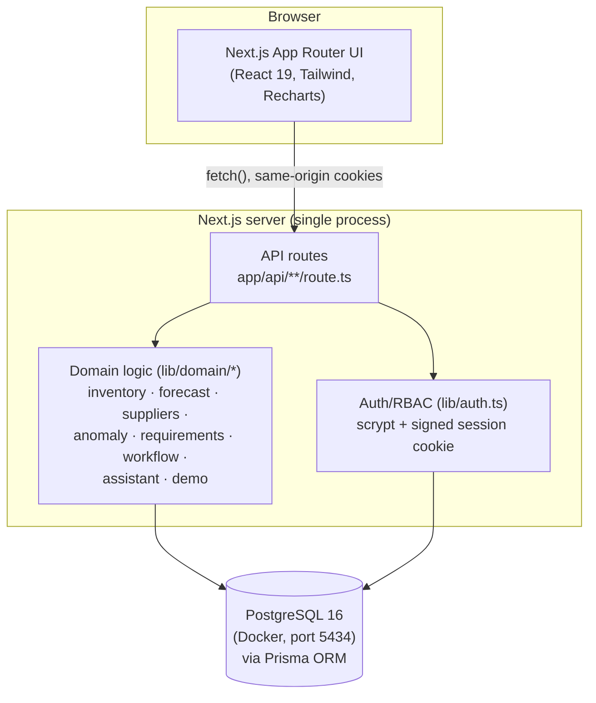
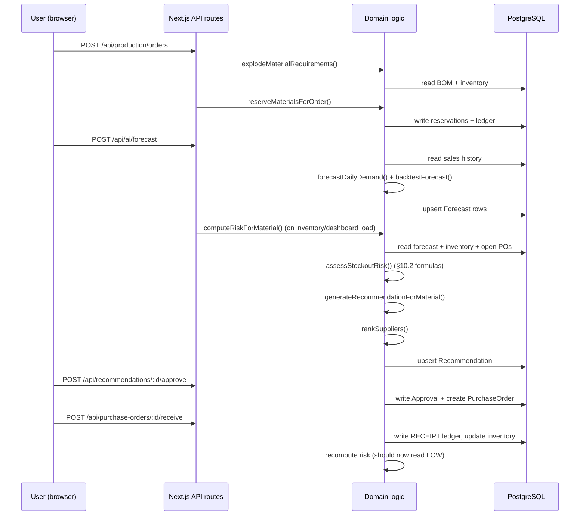

# ForgeAI — System Architecture (Prototype)

## What the blueprint specifies (§8/§9)

Three services: a Next.js/React frontend, a Node/Express + Prisma + PostgreSQL
API, and a separate Python/FastAPI ML service (XGBoost, OR-Tools), talking over
HTTPS/REST.

## What this prototype builds

One service, real database, simplified numerical "brains":



This collapses the blueprint's Node API + Python ML service into one Next.js
process: `app/api/**/route.ts` plays the role of the Express layer, and
`lib/domain/**` plays the role of the FastAPI ML service — same separation of
concerns (HTTP layer vs. numerical engine), same call shape, just not a second
network hop. Splitting `lib/domain` out into a standalone FastAPI service later
is a lift-and-shift, not a rewrite, because it already returns plain JSON-able
objects and touches the database through well-defined functions only.

## Why the ML pieces are simplified, not stubbed

| Engine | Blueprint | Prototype | Why this is a fair substitute |
|---|---|---|---|
| Demand forecast | XGBoost / time-series baseline | Seasonal-naive + trend, `lib/domain/forecast.ts` | §12 explicitly lists "time-series baseline" as an acceptable technique; this is that baseline, computed for real from the seeded 270-day sales history, with a genuine backtest (MAE/RMSE/MAPE/R²) |
| Stockout risk | Rules + probabilistic/ML model | The §10.2 formulas, verbatim, `lib/domain/inventory.ts` | The blueprint's own formulas ARE rule-based; nothing to substitute |
| Supplier ranking | Weighted scoring / optimization | Weighted scoring, `lib/domain/suppliers.ts` | Directly matches the blueprint's own stated technique |
| Machine anomaly detection | Isolation Forest / supervised model | Multivariate z-score against a per-machine baseline, `lib/domain/anomaly.ts` | Same input/output contract (sensor vector → 0-1 anomaly score); swapping in a trained Isolation Forest later replaces one function |
| Production scheduling (OR-Tools) | Linear programming | **Not implemented** | Genuinely deferred — flagged in SRS §6, not silently dropped |
| AI assistant | LLM with tool/function calling | Deterministic intent parser calling the same tool functions, `lib/domain/assistant.ts` | Implements the exact §13 tool set (`get_inventory`, `get_forecast`, `get_open_purchase_orders`, `get_supplier_options`, `calculate_requirement`, `create_purchase_request`, `record_approval_requirement`) against the real engine; swapping in a real LLM means replacing the intent parser with a tool-calling loop, not touching the tools |

Nothing in the risk, inventory, production, or procurement path is hardcoded
demo data — every number the UI shows is computed from the seeded dataset at
request time.

## Data flow for the core scenario (blueprint §6)



## Tech stack actually used

| Layer | Blueprint | Prototype |
|---|---|---|
| Frontend | Next.js + React | Next.js 16 (App Router) + React 19 |
| Styling | Tailwind CSS | Tailwind CSS v4 |
| Charts | Recharts | Recharts |
| Backend | Node.js + Express | Next.js API routes (route handlers) |
| ORM | Prisma | Prisma |
| Database | PostgreSQL | PostgreSQL 16, Docker Compose, port 5434 |
| AI service | Python + FastAPI | Not used — TypeScript domain modules in-process |
| ML | Pandas/NumPy/scikit-learn/XGBoost | Plain TypeScript (no ML dependency) |
| Optimization | OR-Tools / PuLP | Not implemented |
| LLM | LLM API with tool calling | Deterministic rule-based agent (no LLM dependency, no API key required) |
| Containerization | Docker | Docker Compose for Postgres only (app runs via `npm run dev`) |

## Repository layout

```
forgeai/
├── app/
│   ├── (app)/            # authenticated pages: dashboard, inventory, products, …
│   ├── api/               # route handlers (the "Express layer")
│   └── login/
├── components/ui.tsx      # shared UI primitives
├── lib/
│   ├── domain/            # the numerical engine (forecast, inventory, suppliers, …)
│   ├── auth.ts, password.ts, prisma.ts, api.ts, client.ts
├── prisma/
│   ├── schema.prisma
│   └── seed.ts            # synthetic dataset generator
├── docs/                  # this folder
└── docker-compose.yml     # PostgreSQL only
```
