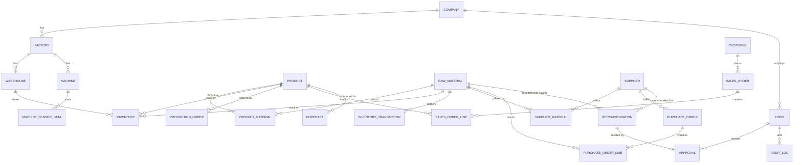

# ForgeAI — Entity-Relationship Diagram

Source of truth is [`prisma/schema.prisma`](../prisma/schema.prisma); this is a
rendered view of it, grouped the way blueprint §10 groups entities.



## Key relationships (blueprint §10.1, unchanged)

```
Company 1──N Factory
Factory 1──N Warehouse
Factory 1──N Machine
Product 1──N ProductMaterial N──1 RawMaterial   (the BOM)
Warehouse 1──N Inventory
RawMaterial 1──N Inventory
Product 1──N ProductionOrder
Supplier N──N RawMaterial   (through SupplierMaterial)
Supplier 1──N PurchaseOrder
ProductionOrder → (BOM explosion) → material reservation, not a stored 1:N table
Machine 1──N MachineSensorData
Recommendation 1──1 Approval
Approval → AuditLog (via recordAudit(), not a stored FK — audit log references any entity type)
```

## Deliberate simplification vs. blueprint §10

The blueprint lists `PurchaseRequest`, `PurchaseOrder`, `GoodsReceipt` as three
entities. This prototype merges `PurchaseRequest` into `Recommendation` (the
AI-generated, human-approved request *is* the purchase request) and treats
"goods receipt" as a status transition + ledger entries on `PurchaseOrder`
rather than a separate table. See [SRS.md §6](SRS.md#6-prototype-simplifications).
